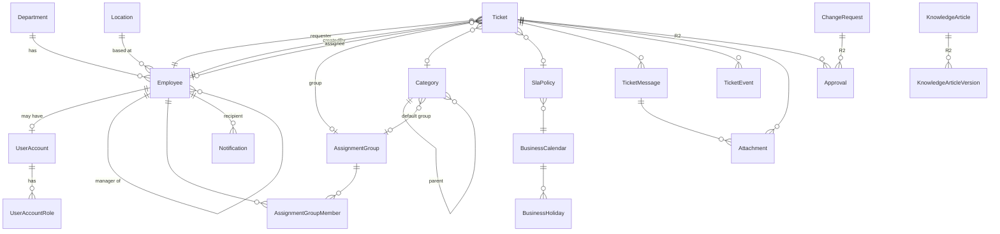

# Document C — DATABASE_DESIGN.md
Status: PLANNING ARTIFACT. Do not execute. Sonnet implements this in Phase 2 against **local Docker Postgres only**.

## 1. Principles

1. **No tenant/organisation tables or `tenantId` columns.** Company-wide settings live in `company_setting` (key/value).
2. **Directory identity vs application account:**
   - `Employee` is a person in the company directory, keyed by the Entra object ID (`oid`). It exists even if the person has never signed in.
   - `UserAccount` is that person's application access (role, status, session version). It is created at first sign-in or when an admin pre-grants a role.
   - **Every person foreign key in business tables references `Employee.id`.** A requester may never have signed in.
3. `Ticket.requesterEmployeeId` and `Ticket.createdByEmployeeId` are both required. They are equal for Form B and differ for Form A. (These are the `requesterUserId` / `createdByUserId` of the brief, named after the table they reference.)
4. Requester details are **snapshotted** on the ticket (name, email, department, job title, location) so history stays accurate after directory changes.
5. Keys:
   - UUID primary keys (`@default(uuid()) @db.Uuid`).
   - Human numbers come from Postgres sequences.
   - Email is never a unique identity key. It is indexed for lookup only.
6. Soft delete:
   - Tickets are archived (`archivedAt`), never hard-deleted by the app.
   - Messages are redacted (`deletedAt`).
   - Attachments are soft-deleted, then purged by a job.
   - Employees are never deleted (`directoryDeletedAt`).
   - Configuration rows use `active`.
7. Every mutation writes `ticket_event` (ticket timeline) and/or `audit_log` (security/compliance) in the same transaction.
8. Extensions: `pgcrypto` (uuid fallback) and `pg_trgm` for name search. **[EXTERNAL]** Confirm the company PG allows `pg_trgm`. The fallback is `lower(display_name) text_pattern_ops` prefix search. No `pgvector`.
9. Postgres major version: the new Neon project **must** match the company's target major version **[OPEN/EXTERNAL]**. A dump from a newer server does not restore reliably into an older one. The original project runs PG 18.

## 2. Entity overview



## 3. Roles and permissions

### 3.1 Role mapping (Entra app roles → application roles)

| App role (DB enum) | Entra app role value | Assigned to (recommended) | Notes |
|---|---|---|---|
| `employee` | `ITSM.User` (default) or none | "All employees" group | Implicit for every signed-in eligible member |
| `submitter` [OPEN] | `ITSM.Submitter` | e.g. reception or HR coordinators | Can use Form A and see tickets they created. Include only if IT confirms |
| `agent` | `ITSM.Agent` | IT support groups | Queue-scoped |
| `manager` | `ITSM.Manager` | IT managers | Oversight + reporting |
| `admin` | `ITSM.Admin` | IT administrators (≤ 3) | Configuration |
| — Super Admin | not created | — | [RECOMMENDATION] not needed. Break-glass is handled by Entra (assigning ITSM.Admin). A DB-level emergency script is documented in Phase 16 |

The effective role is the highest of the assigned roles, stored in `UserAccountRole` with `source = entra | manual`. Manual grants are admin-only and audited. Entra-sourced roles are replaced at every sign-in.

### 3.2 Permission matrix (server-enforced; code constant in `modules/identity/permissions.ts`)

| Capability | employee | submitter | agent | manager | admin |
|---|---|---|---|---|---|
| View own tickets (requester) | ✔ | ✔ | ✔ | ✔ | ✔ |
| View tickets they created | ✔ | ✔ | ✔ | ✔ | ✔ |
| View queue tickets (assigned to self or own groups; triage group sees unassigned) | — | — | ✔ | ✔ | ✔ |
| View all tickets | — | — | [OPEN] default ✘ | ✔ | ✔ |
| Create own ticket (Form B) | ✔ | ✔ | ✔ | ✔ | ✔ |
| Create on behalf (Form A) | — | ✔ | ✔ | ✔ | ✔ |
| Search directory | — | ✔ | ✔ | ✔ | ✔ |
| Public reply on visible ticket | ✔ (own) | ✔ (created) | ✔ | ✔ | ✔ |
| Internal notes (read/write) | — | — | ✔ | ✔ | ✔ |
| Assign to self / within own groups | — | — | ✔ | ✔ | ✔ |
| Reassign to any group/agent | — | — | ✔ (to groups) | ✔ | ✔ |
| Edit priority / category | — | — | ✔ (priority override needs reason) | ✔ | ✔ |
| Resolve | — | — | ✔ | ✔ | ✔ |
| Confirm resolution / reopen within window | ✔ (own) | — | ✔ | ✔ | ✔ |
| Close | system auto-close; ✔ own on confirm | — | ✔ | ✔ | ✔ |
| Cancel | ✔ own while `new` | ✔ created while `new` | ✔ | ✔ | ✔ |
| Escalate (manual) | — | — | ✔ | ✔ | ✔ |
| Approve (R2) | ✔ when named approver | ✔ when named | ✔ when named | ✔ | ✔ |
| Archive (soft-delete) | — | — | — | ✔ | ✔ |
| Dashboards: own | ✔ | ✔ | ✔ | ✔ | ✔ |
| Reports: team / all | — | — | team | all | all |
| Audit log view | — | — | ticket timeline only | ✔ | ✔ |
| Configure groups, categories, SLA, calendars, settings | — | — | — | groups membership [OPEN] | ✔ |
| Manage user roles (manual grants), disable accounts | — | — | — | — | ✔ |

Record-level rule (`canViewTicket`): the actor is the requester, OR the actor is the creator, OR the actor has `ticket.view.all`, OR (the actor is an agent AND (assignee = actor OR the group is one of the actor's groups OR (the group is null AND the actor is in a triage group))). Internal messages and their attachments require an agent-or-higher role **and** `canViewTicket`.

## 4. Proposed Prisma schema (launch scope + R2 placeholders)

```prisma
generator client { provider = "prisma-client-js" }
datasource db {
  provider  = "postgresql"
  url       = env("DATABASE_URL")
  directUrl = env("DIRECT_URL")
}

// ---------- Enums ----------
enum AppRole        { employee submitter agent manager admin }
enum RoleSource     { entra manual }
enum AccountStatus  { active disabled }
enum TicketType     { incident service_request }
enum TicketStatus   { new assigned in_progress on_hold resolved closed cancelled }
enum HoldReason     { awaiting_requester awaiting_vendor awaiting_change scheduled other }
enum Priority       { p1 p2 p3 p4 }            // [OPEN] P5 if IT uses 5 levels
enum Level          { low medium high }
enum TicketChannel  { portal phone walk_in email teams chat }
enum MessageVisibility { public internal }
enum AuthorKind     { employee agent system }
enum AttachmentStatus { staged linked deleted }
enum ScanStatus     { not_scanned pending clean infected failed }
enum StorageProvider { database s3 azure_blob local }
enum GroupStrategy  { manual round_robin least_loaded }
enum GroupMemberRole { member lead }
enum JobStatus      { queued running succeeded failed dead }
enum ApprovalState  { pending approved rejected cancelled }   // R2

// ---------- Organisation ----------
model Department {
  id             String   @id @default(uuid()) @db.Uuid
  name           String   @unique                  // display name
  directoryName  String?  @unique                  // exact Entra `department` value it maps from
  active         Boolean  @default(true)
  createdAt      DateTime @default(now())
  updatedAt      DateTime @updatedAt
  employees      Employee[]
}

model Location {
  id            String   @id @default(uuid()) @db.Uuid
  name          String   @unique
  directoryName String?  @unique                    // Entra officeLocation value
  timezone      String?                             // IANA
  active        Boolean  @default(true)
  employees     Employee[]
}

// ---------- Directory identity ----------
model Employee {
  id                  String    @id @default(uuid()) @db.Uuid
  entraObjectId       String    @unique @db.Uuid     // Entra `oid` — the stable key
  userPrincipalName   String                          // may change (rename)
  mail                String?                         // may be null/changed; NOT unique key
  displayName         String
  givenName           String?
  surname             String?
  employeeNumber      String?                         // Entra employeeId (optional)
  jobTitle            String?
  departmentId        String?   @db.Uuid
  departmentRaw       String?                         // raw Entra department text
  locationId          String?   @db.Uuid
  officeLocationRaw   String?
  businessPhone       String?
  mobilePhone         String?
  managerId           String?   @db.Uuid
  accountEnabled      Boolean   @default(true)
  isEligible          Boolean   @default(true)       // passes employee filter (member, not shared mailbox…)
  lastSyncedAt        DateTime?
  directoryDeletedAt  DateTime?                       // removed from Entra; never hard-deleted
  createdAt           DateTime  @default(now())
  updatedAt           DateTime  @updatedAt

  department  Department? @relation(fields: [departmentId], references: [id], onDelete: SetNull)
  location    Location?   @relation(fields: [locationId], references: [id], onDelete: SetNull)
  manager     Employee?   @relation("Manager", fields: [managerId], references: [id], onDelete: SetNull)
  reports     Employee[]  @relation("Manager")
  account     UserAccount?
  groupMemberships AssignmentGroupMember[]
  ticketsRequested Ticket[] @relation("Requester")
  ticketsCreated   Ticket[] @relation("CreatedBy")
  ticketsAssigned  Ticket[] @relation("Assignee")
  notifications    Notification[]

  @@index([mail])
  @@index([userPrincipalName])
  @@index([employeeNumber])
  @@index([departmentId])
  @@index([isEligible, accountEnabled, displayName])
  // raw SQL migration: CREATE INDEX employee_search_trgm ON "Employee" USING gin ((lower("displayName"||' '||coalesce("mail",'')||' '||"userPrincipalName"||' '||coalesce("employeeNumber",''))) gin_trgm_ops);
}

// ---------- Application access ----------
model UserAccount {
  id             String        @id @default(uuid()) @db.Uuid
  employeeId     String        @unique @db.Uuid
  status         AccountStatus @default(active)
  role           AppRole       @default(employee)   // effective (highest) role, denormalised
  sessionVersion Int           @default(1)          // bump to revoke sessions
  lastSignInAt   DateTime?
  disabledAt     DateTime?
  disabledReason String?
  preferences    Json?
  createdAt      DateTime      @default(now())
  updatedAt      DateTime      @updatedAt
  employee       Employee      @relation(fields: [employeeId], references: [id], onDelete: Restrict)
  roles          UserAccountRole[]
  @@index([role, status])
}

model UserAccountRole {
  userAccountId String     @db.Uuid
  role          AppRole
  source        RoleSource
  grantedById   String?    @db.Uuid     // Employee.id for manual grants
  grantedAt     DateTime   @default(now())
  userAccount   UserAccount @relation(fields: [userAccountId], references: [id], onDelete: Cascade)
  @@id([userAccountId, role, source])
}

// ---------- Assignment ----------
model AssignmentGroup {
  id             String        @id @default(uuid()) @db.Uuid
  name           String        @unique
  description    String?
  email          String?
  isTriage       Boolean       @default(false)   // sees unassigned-group tickets
  strategy       GroupStrategy @default(manual)
  rrCursor       Int           @default(0)
  teamsWebhookUrlRef String?                     // R2: name of env/secret, not the URL itself
  active         Boolean       @default(true)
  createdAt      DateTime      @default(now())
  updatedAt      DateTime      @updatedAt
  members        AssignmentGroupMember[]
  categories     Category[]
  tickets        Ticket[]
}

model AssignmentGroupMember {
  groupId    String          @db.Uuid
  employeeId String          @db.Uuid
  role       GroupMemberRole @default(member)
  addedAt    DateTime        @default(now())
  group      AssignmentGroup @relation(fields: [groupId], references: [id], onDelete: Cascade)
  employee   Employee        @relation(fields: [employeeId], references: [id], onDelete: Cascade)
  @@id([groupId, employeeId])
  @@index([employeeId])
}

model Category {
  id              String      @id @default(uuid()) @db.Uuid
  name            String
  parentId        String?     @db.Uuid
  ticketTypes     TicketType[]
  defaultGroupId  String?     @db.Uuid
  defaultImpact   Level?
  defaultUrgency  Level?
  sortOrder       Int         @default(0)
  active          Boolean     @default(true)
  parent          Category?   @relation("CategoryTree", fields: [parentId], references: [id], onDelete: Restrict)
  children        Category[]  @relation("CategoryTree")
  defaultGroup    AssignmentGroup? @relation(fields: [defaultGroupId], references: [id], onDelete: SetNull)
  tickets         Ticket[]
  @@unique([parentId, name])
}

// ---------- SLA ----------
model BusinessCalendar {
  id        String   @id @default(uuid()) @db.Uuid
  name      String   @unique
  timezone  String                      // IANA, e.g. America/New_York [OPEN]
  workDays  Int[]                       // 1=Mon..7=Sun
  startMinute Int                       // minutes from midnight, e.g. 540
  endMinute   Int                       // e.g. 1080
  holidays  BusinessHoliday[]
  policies  SlaPolicy[]
}
model BusinessHoliday {
  id         String @id @default(uuid()) @db.Uuid
  calendarId String @db.Uuid
  date       DateTime @db.Date
  name       String
  calendar   BusinessCalendar @relation(fields: [calendarId], references: [id], onDelete: Cascade)
  @@unique([calendarId, date])
}
model SlaPolicy {
  id              String      @id @default(uuid()) @db.Uuid
  name            String      @unique
  priority        Priority
  ticketType      TicketType?            // null = applies to all types
  responseMinutes Int
  resolveMinutes  Int
  calendarId      String?     @db.Uuid   // null = 24x7
  active          Boolean     @default(true)
  calendar        BusinessCalendar? @relation(fields: [calendarId], references: [id])
  tickets         Ticket[]
  // raw SQL: CREATE UNIQUE INDEX sla_active_unique ON "SlaPolicy"(priority, coalesce("ticketType"::text,'*')) WHERE active;
}

// ---------- Tickets ----------
model Ticket {
  id                   String        @id @default(uuid()) @db.Uuid
  number               BigInt        @unique @default(autoincrement())   // sequence-backed
  reference            String        @unique                             // e.g. INC0001042 (fixed at creation)
  type                 TicketType
  status               TicketStatus  @default(new)
  holdReason           HoldReason?
  channel              TicketChannel
  subject              String        @db.VarChar(200)
  description          String                                           // ≤ 20,000 chars (validated)
  categoryId           String?       @db.Uuid
  impact               Level
  urgency              Level
  priority             Priority
  priorityOverridden   Boolean       @default(false)
  priorityOverrideReason String?
  typeDetails          Json?                                            // sanitised per type

  requesterEmployeeId  String        @db.Uuid
  createdByEmployeeId  String        @db.Uuid
  requesterName        String                                           // snapshot
  requesterEmail       String?                                          // snapshot
  requesterDepartment  String?                                          // snapshot
  requesterJobTitle    String?                                          // snapshot
  requesterLocation    String?                                          // snapshot (may be overridden by caller text)
  contactPhone         String?

  assignmentGroupId    String?       @db.Uuid
  assigneeEmployeeId   String?       @db.Uuid

  slaPolicyId          String?       @db.Uuid
  responseDueAt        DateTime?
  resolveDueAt         DateTime?
  firstRespondedAt     DateTime?
  slaPausedAt          DateTime?
  slaPausedMinutes     Int           @default(0)
  responseBreachedAt   DateTime?     // set by job (for reporting/notification), display derives from dueAt
  resolveBreachedAt    DateTime?

  resolvedAt           DateTime?
  resolvedByEmployeeId String?       @db.Uuid
  resolutionCode       String?
  resolutionNotes      String?
  closedAt             DateTime?
  reopenCount          Int           @default(0)

  idempotencyKey       String?
  version              Int           @default(0)      // optimistic concurrency
  archivedAt           DateTime?
  archivedByEmployeeId String?       @db.Uuid
  createdAt            DateTime      @default(now())
  updatedAt            DateTime      @updatedAt

  requester       Employee         @relation("Requester", fields: [requesterEmployeeId], references: [id], onDelete: Restrict)
  createdBy       Employee         @relation("CreatedBy", fields: [createdByEmployeeId], references: [id], onDelete: Restrict)
  assignee        Employee?        @relation("Assignee", fields: [assigneeEmployeeId], references: [id], onDelete: SetNull)
  assignmentGroup AssignmentGroup? @relation(fields: [assignmentGroupId], references: [id], onDelete: SetNull)
  category        Category?        @relation(fields: [categoryId], references: [id], onDelete: SetNull)
  slaPolicy       SlaPolicy?       @relation(fields: [slaPolicyId], references: [id], onDelete: SetNull)
  messages        TicketMessage[]
  events          TicketEvent[]
  attachments     Attachment[]

  @@unique([createdByEmployeeId, idempotencyKey])
  @@index([status, assignmentGroupId, priority])
  @@index([assigneeEmployeeId, status])
  @@index([requesterEmployeeId, createdAt(sort: Desc)])
  @@index([createdByEmployeeId, createdAt(sort: Desc)])
  @@index([createdAt])
  @@index([archivedAt])
  // raw SQL: partial index for SLA sweeps
  // CREATE INDEX ticket_open_resolve_due ON "Ticket"("resolveDueAt") WHERE status IN ('new','assigned','in_progress') AND "archivedAt" IS NULL;
  // raw SQL: full-text  ALTER TABLE "Ticket" ADD COLUMN search tsvector GENERATED ALWAYS AS (to_tsvector('simple', coalesce(reference,'')||' '||subject||' '||description)) STORED; CREATE INDEX ticket_search ON "Ticket" USING gin(search);
  // raw SQL: CHECK (("status" = 'on_hold') = ("holdReason" IS NOT NULL))
}

model TicketMessage {
  id               String            @id @default(uuid()) @db.Uuid
  ticketId         String            @db.Uuid
  authorEmployeeId String?           @db.Uuid     // null for system
  authorKind       AuthorKind
  visibility       MessageVisibility @default(public)
  body             String
  createdAt        DateTime          @default(now())
  editedAt         DateTime?
  deletedAt        DateTime?
  deletedByEmployeeId String?        @db.Uuid
  ticket           Ticket            @relation(fields: [ticketId], references: [id], onDelete: Restrict)
  attachments      Attachment[]
  @@index([ticketId, createdAt])
}

model TicketEvent {                     // user-visible timeline
  id              String   @id @default(uuid()) @db.Uuid
  ticketId        String   @db.Uuid
  type            String   // created | status_changed | assigned | group_changed | priority_changed | message_added | attachment_added | sla_breached | escalated | reopened | archived
  actorEmployeeId String?  @db.Uuid
  fromValue       String?
  toValue         String?
  data            Json?
  createdAt       DateTime @default(now())
  ticket          Ticket   @relation(fields: [ticketId], references: [id], onDelete: Restrict)
  @@index([ticketId, createdAt])
  @@index([type, createdAt])
}

// ---------- Attachments ----------
model Attachment {
  id                   String           @id @default(uuid()) @db.Uuid
  ticketId             String?          @db.Uuid        // null while staged
  messageId            String?          @db.Uuid
  status               AttachmentStatus @default(staged)
  storageProvider      StorageProvider
  storageKey           String           @unique         // itsm/{env}/att/{yyyy}/{mm}/{uuid}
  fileName             String           @db.VarChar(255)
  contentType          String
  sizeBytes            Int
  sha256               String           @db.Char(64)
  scanStatus           ScanStatus       @default(not_scanned)
  scannedAt            DateTime?
  uploadedByEmployeeId String           @db.Uuid
  createdAt            DateTime         @default(now())
  linkedAt             DateTime?
  deletedAt            DateTime?
  ticket               Ticket?          @relation(fields: [ticketId], references: [id], onDelete: Restrict)
  message              TicketMessage?   @relation(fields: [messageId], references: [id], onDelete: SetNull)
  @@index([ticketId])
  @@index([status, createdAt])
  @@index([uploadedByEmployeeId, status])
}

model StoredObject {                    // ONLY used by DatabaseObjectStorage (temporary)
  key         String   @id
  contentType String
  data        Bytes
  createdAt   DateTime @default(now())
}

// ---------- Notifications, jobs, audit ----------
model Notification {
  id                  String    @id @default(uuid()) @db.Uuid
  recipientEmployeeId String    @db.Uuid
  type                String
  title               String
  body                String
  link                String?
  ticketId            String?   @db.Uuid
  readAt              DateTime?
  createdAt           DateTime  @default(now())
  recipient           Employee  @relation(fields: [recipientEmployeeId], references: [id], onDelete: Cascade)
  @@index([recipientEmployeeId, readAt, createdAt(sort: Desc)])
}

model Job {
  id          String    @id @default(uuid()) @db.Uuid
  kind        String              // notify.email | notify.in_app | notify.teams | sla.evaluate | directory.sync | attachments.cleanup | ticket.autoclose
  payload     Json
  dedupeKey   String?   @unique
  status      JobStatus @default(queued)
  attempts    Int       @default(0)
  maxAttempts Int       @default(8)
  runAfter    DateTime  @default(now())
  lockedBy    String?
  lockedUntil DateTime?
  lastError   String?
  createdAt   DateTime  @default(now())
  completedAt DateTime?
  @@index([status, runAfter])
}

model JobSchedule {                     // recurring-job slot lease
  name          String    @id
  lastSlotAt    DateTime?
  leaseOwner    String?
  leaseUntil    DateTime?
  lastSuccessAt DateTime?
  lastError     String?
  cursor        String?               // e.g. Graph deltaLink for directory sync
}

model AuditLog {
  id              BigInt   @id @default(autoincrement())
  occurredAt      DateTime @default(now())
  actorEmployeeId String?  @db.Uuid
  actorType       String   // user | system | job
  action          String   // auth.signin, ticket.create, ticket.assign, role.grant, account.disable, attachment.download ...
  entityType      String
  entityId        String?
  ticketId        String?  @db.Uuid
  requestId       String?
  ipHash          String?             // hashed client IP [OPEN: privacy policy]
  changes         Json?               // {field: [before, after]} — never secrets, never attachment bytes
  @@index([entityType, entityId])
  @@index([ticketId])
  @@index([actorEmployeeId, occurredAt])
  @@index([action, occurredAt])
}

model RateLimitBucket {
  key       String   @id
  count     Int
  resetAt   DateTime
  @@index([resetAt])
}

model CompanySetting {
  key           String   @id           // e.g. "ticket.autoCloseDays", "ticket.reopenWindowDays"
  value         Json
  updatedById   String?  @db.Uuid
  updatedAt     DateTime @updatedAt
}

// ---------- Release 2 (create in a later migration, not in baseline) ----------
// model Approval { id, ticketId?, changeId?, approverEmployeeId, step Int, state ApprovalState, comment, requestedById, decidedAt, createdAt
//   @@unique([ticketId, approverEmployeeId, step]) ; CHECK exactly one of ticketId/changeId }
// model ChangeRequest { id, number seq, reference unique, type (standard|normal|emergency), status, risk Level, impact Level, title, description,
//   implementationPlan, backoutPlan, testPlan, plannedStart, plannedEnd, actualStart, actualEnd, requestedById, ownerEmployeeId, assignmentGroupId,
//   createdAt, updatedAt, archivedAt ; @@index([status, plannedStart]) }
// model ChangeTicketLink { changeId, ticketId @@id([changeId, ticketId]) }
// model KnowledgeArticle { id, slug unique, title, body, categoryId?, status (draft|in_review|published|archived), audience (employees|agents),
//   currentVersion Int, authorEmployeeId, publishedAt, archivedAt, search tsvector GENERATED ; @@index([status, audience]) }
// model KnowledgeArticleVersion { articleId, version, title, body, editedById, createdAt  @@id([articleId, version]) }
// model CannedResponse { id, name unique, body, groupId?, active }
// model SatisfactionResponse { id, ticketId unique, rating 1..5, comment, createdAt }
// model TicketLink { fromTicketId, toTicketId, kind (duplicate_of|related|caused_by)  @@id([fromTicketId,toTicketId,kind]) }
```

## 5. Reference generation

- `Ticket.number` comes from the identity/sequence, which is gap-tolerant and unique.
- `reference = PREFIX[type] + lpad(number, 7, '0')` (`INC0001042`, `REQ0001043`), computed in the same `INSERT … RETURNING`, or by a second update inside the same transaction.
- [OPEN] Format confirmation. The reference stays fixed if the type is later changed.

## 6. Entra object ID → Employee mapping

1. At sign-in, `oid` and `tid` are read from the validated ID token claims (not from Auth.js `providerAccountId`, which is the pairwise `sub`).
2. `Employee` is upserted `WHERE entraObjectId = oid`. Mutable attributes (UPN, mail, display name) are updated; the key never changes.
3. If no `Employee` exists (not yet synced), it is created from the token claims and a Graph `/users/{oid}` read.
4. If `isEligible = false` (guest, service account) or `accountEnabled = false`, sign-in is denied.
5. `UserAccount` is upserted by `employeeId`. If `status = disabled` (an admin action), sign-in is denied regardless of Entra.
6. Email is used only for display, notifications and *search*. If two employees ever share a mail value (rehire, alias), nothing breaks.

## 7. Requester/creator representation

| Scenario | requesterEmployeeId | createdByEmployeeId | channel |
|---|---|---|---|
| Form B, employee self-service | session employee | session employee | `portal` |
| Form A, agent logs a phone call for Jane | Jane (selected from directory, re-loaded server-side) | agent | `phone` / `walk_in` / `email` / `teams` / `chat` |
| R2 email intake | sender matched by mail → Employee (unmatched senders are held for agent review, never auto-created) | = requester. The `created` event's `data` records `{source: "email_intake", messageId}` | `email` |

## 8. Data volume and performance assumptions [ASSUMPTION]

- 2,000 employees and about 15–40k tickets per year. Messages are about 5× tickets. Attachments average 300 KB.
- All list queries are paginated (max 100) and use the indexes above. There is no in-memory filtering.
- Neon is limited to 1 GB logical size per branch on the current plan [VERIFIED for the old project; check the plan for the new one]. Database-stored attachments make this the binding limit, which is why object storage is required before production volume.

## 9. Database roles [RECOMMENDATION]

- `itsm_migrator`: owns the schema and is used only by `prisma migrate deploy` (`DIRECT_URL`).
- `itsm_app`: SELECT/INSERT/UPDATE/DELETE on app tables. On `AuditLog` it has **INSERT/SELECT only**. It is used by the runtime (`DATABASE_URL`).
- Grants are applied in a dedicated SQL migration after the baseline, so they are portable to company PG.
