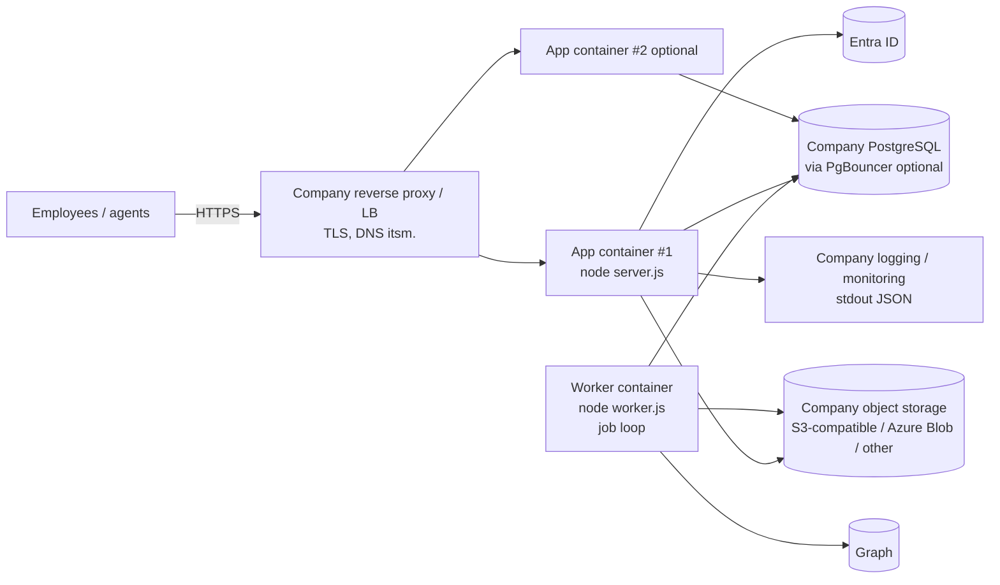

# Document A — SOLUTION_ARCHITECTURE.md
Netlink ITSM — single-company internal service desk. Status: PLANNING ARTIFACT.

## 1. Goals and constraints

- [CONFIRMED] There is one company and one Entra tenant, with roughly 500–2,000 employees. There are no tenants, no onboarding and no billing.
- [CONFIRMED] Sign-in is through Entra ID OIDC only. No demo, password or self-registration sign-in exists.
- [CONFIRMED] There are two ticket-creation experiences (agent-assisted and self-service) on one shared backend service.
- [CONFIRMED] Temporary hosting is Vercel, an isolated Neon database and isolated attachment storage. The application must later move to company-provided servers without rewriting business logic.
- [RECOMMENDATION] The application is a modular monolith: one deployable Next.js app plus an optional worker process built from the same code. There are no microservices, no Kubernetes requirement, no Redis and no message broker.

## 2. System context (temporary hosting)

```mermaid
flowchart LR
  Emp[Employee browser] -- HTTPS --> App
  Agt[IT agent / manager browser] -- HTTPS --> App
  subgraph Vercel["Vercel project: netlink-itsm (NEW)"]
    App[Next.js app<br/>pages + /api route handlers<br/>Node runtime]
    Cron[Vercel Cron] -- "POST /api/internal/jobs/run<br/>Bearer CRON_SECRET" --> App
  end
  App -- OIDC auth code + PKCE --> Entra[(Microsoft Entra ID<br/>company tenant)]
  App -- app-only token --> Graph[(Microsoft Graph<br/>users, sendMail)]
  App -- pooled TLS --> Neon[(Neon project netlink-itsm (NEW)<br/>Postgres: app data + job table<br/>+ stored_object for attachments)]
  App -- HTTPS webhook --> Teams[(Teams Workflows webhook<br/>Release 2)]
  Old[Original app netlink-support.vercel.app] -. NO CONNECTION .- Neon
  Old --> OldNeon[(Neon project netlink-support<br/>UNTOUCHED)]
```

## 3. Future company-hosted architecture



The same image serves both roles. `APP_ROLE=web` runs the Next.js server and `APP_ROLE=worker` runs the job loop. Vercel Cron is replaced by the worker loop. No business code changes are needed.

## 4. Code architecture (modular monolith)

```
src/
  app/                         # Next.js App Router: UI routes + thin API route handlers
    (employee)/                # self-service: /my/tickets, /my/tickets/new, /kb
    (agent)/                   # agent workspace: /desk, /desk/tickets/[ref], /desk/tickets/new
    (admin)/                   # /admin/groups, /admin/categories, /admin/sla, /admin/users
    api/
      auth/[...nextauth]/route.ts
      me/route.ts
      directory/employees/route.ts, [id]/route.ts
      tickets/self/route.ts, tickets/assisted/route.ts
      tickets/route.ts (list), tickets/[ref]/route.ts, [ref]/messages, [ref]/assignment, [ref]/status
      attachments/route.ts (upload), attachments/[id]/route.ts (download)
      notifications/route.ts
      internal/jobs/run/route.ts       # cron/worker trigger, secret-protected
      health/route.ts, ready/route.ts
  modules/                     # domain modules: no Next.js imports
    identity/    (session → Actor, role sync, UserAccount)
    directory/   (Employee, DirectoryProvider port, Graph adapter, sync)
    tickets/     (createTicket, lifecycle state machine, queries, access policy, references)
    assignment/  (groups, membership, routing rules, round-robin)
    sla/         (policies, calendars, due-date calculator, breach evaluation)
    attachments/ (ObjectStorage port, providers, scanner port, validation)
    notifications/ (outbox events → in-app, email, Teams; templates)
    audit/       (append-only audit writer)
    jobs/        (job table, runner, schedules)
    reporting/   (metrics queries)
    knowledge/   (Release 2)   approvals/ (Release 2)   changes/ (Release 2)
  platform/                    # cross-cutting, infra-neutral
    config/ (zod-validated env)  db/ (Prisma client, tx helper)  http/ (error mapping, request id)
    errors/  logging/  rateLimit/  clock/  ids/
  ui/                          # shared React components (design system)
```

Rules ([RECOMMENDATION]; enforced in Phase 1 by an ESLint import rule):
1. `modules/*` never imports `next/*`, `@vercel/*`, or a concrete provider SDK. Providers live in `modules/*/infra/*` and are selected in `platform/config/providers.ts`.
2. Route handlers do four things only: authenticate (`requireActor`), parse input with the zod contract, call one application service, and map the result or error to HTTP.
3. Every mutation runs in one Prisma transaction that writes the entity change, the `TicketEvent`, the `AuditLog` row and the `OutboxJob` rows together (transactional outbox).
4. Authorization lives in the module as policy functions (`canViewTicket(actor, ticket)`). Route handlers call them; UI hiding is cosmetic only.

## 5. Authentication flow

```mermaid
sequenceDiagram
  participant B as Browser
  participant A as App (Auth.js v5)
  participant E as Entra ID (single tenant)
  participant D as DB
  B->>A: GET /desk (no session)
  A-->>B: 302 /signin → "Sign in with Microsoft"
  B->>E: /oauth2/v2.0/authorize (code + PKCE + state + nonce)
  E->>E: MFA / Conditional Access (company policy)
  E-->>B: 302 /api/auth/callback/microsoft-entra-id?code
  B->>A: callback
  A->>E: token exchange (client secret/cert)
  A->>A: validate id_token signature, iss = https://login.microsoftonline.com/{TENANT}/v2.0, aud = CLIENT_ID, nonce, exp
  A->>A: assert tid == ENTRA_TENANT_ID, oid is GUID
  A->>D: upsert Employee by entraObjectId (oid); upsert UserAccount; sync roles from id_token.roles
  alt account disabled in app OR no Employee eligibility
    A-->>B: AccessDenied page
  else
    A-->>B: session cookie (JWT: userAccountId, employeeId, sessionVersion; 8h max)
  end
  B->>A: subsequent API call
  A->>D: load UserAccount (status, role, sessionVersion) — per request, cached per request
  A-->>B: 401 if disabled/version mismatch; else proceed with server-side Actor
```

Key points:
- The role in the JWT is a **hint only**. Every request reloads `UserAccount` (one indexed PK lookup) and uses the DB role.
- Roles are refreshed from the Entra `roles` claim on every sign-in. The directory sync also disables accounts whose Entra `accountEnabled=false`.
- Sign-out clears the cookie and offers Entra front-channel logout. "Revoke sessions" increments `UserAccount.sessionVersion`.

## 6. Employee directory flow

```mermaid
flowchart TB
  subgraph Sync["Directory sync job (every 30 min + nightly full)"]
    J[jobs runner] --> G1[Graph GET /users/delta $select=...]
    G1 --> F[filter: userType=Member, accountEnabled, eligibility rule]
    F --> U[(Employee upsert by entraObjectId)]
    U --> X[disable UserAccount where accountEnabled=false]
  end
  subgraph Search["Agent search (Form A)"]
    S1[GET /api/directory/employees?q=] --> L[(local Employee table: prefix/trigram search)]
    L -- "< N results & q ≥ 3 chars" --> G2[Graph $search fallback]
    G2 --> U2[(upsert Employee)] --> R[results by Employee.id]
  end
  subgraph Self["Self profile (Form B)"]
    M[GET /api/me/profile] --> E2[(Employee by session employeeId)]
    E2 -- stale > 24h --> G3[Graph GET /users/{oid}] --> E2
  end
```

The local table is the primary source because it is fast, filterable and resilient to Graph throttling. Graph live lookup fills gaps when an employee joined since the last sync. Results always resolve to an `Employee.id`, so a ticket's requester is always a real directory record.

## 7. Ticket creation flows

### 7.1 Form B — employee self-service

```mermaid
sequenceDiagram
  participant B as Employee browser
  participant R as POST /api/tickets/self
  participant S as tickets.createTicket()
  participant D as DB (tx)
  B->>R: {type, categoryId, subject, description, impact?, urgency?, contactPhone?, attachmentIds[]} + Idempotency-Key
  R->>R: requireActor(); reject body if it contains requester* fields (400)
  R->>S: command{ requester: {kind:"self"}, channel:"portal", ... }, actor
  S->>D: load Employee(actor.employeeId) → snapshot
  S->>D: BEGIN; insert Ticket(requester=createdBy=actor.employeeId, number=nextval), link staged attachments owned by actor, compute SLA dues, route to group, insert TicketEvent(created), AuditLog, OutboxJob(notify.ticket_created); COMMIT
  S-->>R: TicketDTO (reference)
  R-->>B: 201 {reference, id}
```

### 7.2 Form A — agent-assisted creation

```mermaid
sequenceDiagram
  participant B as Agent browser
  participant Q as GET /api/directory/employees?q=
  participant R as POST /api/tickets/assisted
  participant S as tickets.createTicket()
  B->>Q: "jsmith"
  Q-->>B: [{id, displayName, mail, employeeId, department, jobTitle, officeLocation}]
  B->>B: select → read-only requester card (display only)
  B->>R: {requesterEmployeeId, channel:"phone", type, categoryId, subject, description, impact, urgency, priorityOverride?, assignmentGroupId?, assigneeEmployeeId?, attachmentIds[]}
  R->>R: requireActor(perm ticket.create.on_behalf)
  R->>S: command{ requester:{kind:"employee", employeeId}, ...}, actor
  S->>S: re-load Employee from DB (client display data ignored); must be active/eligible
  S->>S: same transaction as 7.1; createdBy = actor.employeeId ≠ requester
```

Both flows use the same `createTicket(command, actor)`. That service owns validation, reference generation, attachment linking, the priority matrix, SLA initialisation, routing, events, audit and outbox jobs. The two endpoints differ only in the `requester` resolution strategy and the permissions they require.

## 8. Attachment flow

```mermaid
sequenceDiagram
  participant B as Browser
  participant U as POST /api/attachments (multipart)
  participant P as attachments service
  participant O as ObjectStorage provider
  participant D as DB
  B->>U: file (≤ ATTACHMENT_MAX_BYTES; 4 MB on Vercel)
  U->>P: validate name/ext/MIME allowlist, magic-byte sniff, size, sha256
  P->>O: put(key="itsm/{env}/att/{yyyy}/{mm}/{uuid}", bytes, contentType)
  P->>D: Attachment{status: staged, uploadedBy, ticketId: null, scanStatus: pending|not_scanned}
  P-->>B: {attachmentId}
  Note over B,D: createTicket / addMessage links staged attachments owned by the actor (tx)
  B->>D: GET /api/attachments/{id} → policy canViewTicket + message visibility → stream bytes, Content-Disposition: attachment, nosniff
  Note over D: daily job deletes staged > 24h (DB row + object)
```

Providers: `DatabaseObjectStorage` (temporary, `stored_object` table in the **new** DB), `S3ObjectStorage` and `AzureBlobObjectStorage` (future, chosen by `STORAGE_PROVIDER`), and `LocalDiskObjectStorage` (dev only, refuses to start in production). A future presigned direct-upload path (`createUploadUrl`) is optional and only for providers that support it.

## 9. Notification flow

```
domain mutation (tx) ──► OutboxJob rows {kind: notify.*, dedupeKey}
                          │
jobs runner ──────────────┴─► NotificationDispatcher
        ├─ in_app  → Notification row (recipientEmployeeId)       [launch]
        ├─ email   → MailSender port → GraphMailSender | SmtpMailSender | NoopMailSender   [launch, provider OPEN]
        └─ teams   → TeamsNotifier port → WorkflowsWebhookNotifier | Noop                 [Release 2]
```

After the response, the request handler calls `after(() => runDueJobs({ maxJobs: 10 }))` (Next.js `after`, platform-neutral) for fast delivery. Cron or the worker is the guaranteed path. Jobs are idempotent through `dedupeKey`, retried with exponential backoff, and marked `dead` after N attempts.

## 10. Background job flow

- One table, `job`, holds work (`status`, `runAfter`, `attempts`, `lockedUntil`, `lockedBy`). Claiming uses `UPDATE … WHERE id IN (SELECT … FOR UPDATE SKIP LOCKED LIMIT n) RETURNING *` inside a transaction. This is safe with PgBouncer transaction pooling and with multiple instances.
- Recurring schedules (SLA evaluation, directory sync, staged-attachment cleanup, auto-close) are enqueued by the runner from a code-defined schedule table, using a `job_schedule` row lease so they never run twice per slot.
- Triggers:
  - Vercel Cron calls `/api/internal/jobs/run` ([EXTERNAL] per-minute cron needs a paid Vercel plan; Hobby is daily, so the fallback is an external pinger or GitHub Actions schedule).
  - Self-hosted: `node worker.js` loops every 15 s.
- **Correctness rule:** SLA breach status is computed from `responseDueAt`/`resolveDueAt` at read time. Jobs only send notifications and escalations, so a missed cron delays emails but never shows wrong SLA data.

## 11. Multi-instance readiness

| Concern | Original | New design |
|---|---|---|
| DB connections | Prisma singleton, Neon pooler | Prisma with `DATABASE_URL` → pooler (`pgbouncer=true&connection_limit=5` on serverless); `DIRECT_URL` only for migrations |
| Rate limiting | In-process `Map` | `rate_limit_bucket` table, atomic upsert; key = userAccountId or trusted client IP |
| Live updates | In-process EventEmitter SSE | Polling (30 s lists, 15 s open ticket) at launch; future: SSE fed by Postgres LISTEN/NOTIFY from the worker, if needed |
| Background work | `setInterval` + session advisory lock | Job table + SKIP LOCKED + row leases |
| Idempotency | Header hash, integration-scoped | `Idempotency-Key` unique per (createdByEmployeeId, key) on ticket create |
| File storage | DB or Azure; container auto-create | Provider port; no local disk in prod; object key namespaced; container pre-provisioned |
| Concurrent edits | `updateIf` compare-and-set | `Ticket.version` optimistic concurrency (409 on mismatch) |
| Sessions | JWT | JWT + per-request DB check; no sticky sessions needed |

## 12. Deployment architecture

| | Temporary (Phase 13) | Future (Phase 16) |
|---|---|---|
| Runtime | Vercel, Node 22 functions, region matching Neon | Docker image `node:22-alpine`, Next standalone `server.js` + `worker.js` |
| Database | New Neon project `netlink-itsm`, branches `main` (prod), `staging` | Company PostgreSQL (same major version) |
| Attachments | `DatabaseObjectStorage` in the new Neon DB (≤ 4 MB/file) | Company object storage provider |
| Jobs | Vercel Cron → `/api/internal/jobs/run` | Worker container |
| Secrets | Vercel env vars (Preview vs Production scopes) | Company secret manager → env vars |
| DNS/TLS | `*.vercel.app` or custom domain | Company DNS + reverse proxy TLS |
| Logs | Vercel logs (JSON stdout) | Company log pipeline (same JSON) |

## 13. Security architecture summary

- **Authentication:** Entra only. Secure, HttpOnly, SameSite=Lax cookies. CSRF protection comes from Auth.js plus same-origin checks on mutating API routes (`Origin` header must equal `APP_BASE_URL`).
- **Authorization:** a permission matrix (Doc C §3) plus record-level policies, all server-side.
- **Input:** zod contracts on every endpoint, with body size limits.
- **Headers:** reuse the original's security headers, tightened. CSP drops `'unsafe-eval'` in production (to be verified with Next 16), and `frame-ancestors 'none'`.
- **Audit:** append-only `audit_log`. The app DB role gets no UPDATE/DELETE grant on it (Phase 11).
- **Secrets:** never in the repo. The env check validates presence and shape and is provider-neutral (no `neon.tech` check).
- **Least privilege DB roles:** `itsm_migrator` (DDL) and `itsm_app` (DML).
